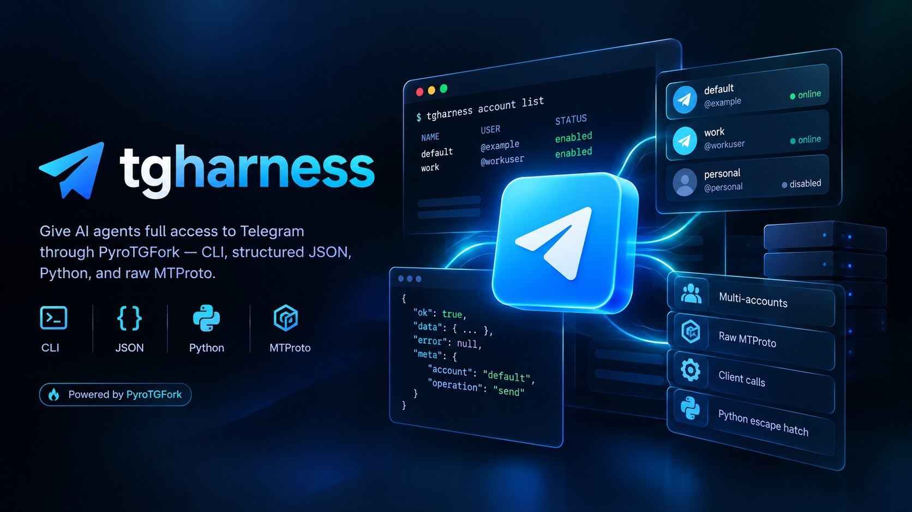

<div align="center">



# ⚡ tgharness

### *Telegram MTProto Harness for AI Agents, powered by PyroTGFork*

[](LICENSE)
[](https://telegramplayground.github.io/pyrogram/index.html)
[](https://core.telegram.org/mtproto)
[](https://www.python.org)
[](#what-it-gives-an-agent)
[](#give-this-to-your-agent)

<p align="center">
  <code>tgharness</code> gives an agent a stable CLI/JSON interface to one or many Telegram accounts while keeping the full PyroTGFork surface reachable through dynamic Client calls, Raw MTProto, and a Python escape hatch.
</p>

[Features](#what-it-gives-an-agent) • [Give This To Your Agent](#give-this-to-your-agent) • [Install](#install) • [Setup & Login](#setup-and-first-account) • [Multi-Account](#multi-account-sessions) • [Common Operations](#common-telegram-operations) • [JSON Protocol](#json-protocol)

---

</div>

> [!IMPORTANT]
> This project uses **PyroTGFork**, installed as `pyrotgfork` and imported through the `pyrogram` Python namespace. API behavior and signatures must be checked against the [PyroTGFork documentation](https://telegramplayground.github.io/pyrogram/index.html), not upstream Pyrogram documentation.

## What it gives an agent

- **Multi-account sessions** — register multiple Telegram accounts and keep separate PyroTGFork session files.
- **Account targeting** — run an operation as the default account, one named account, several selected accounts, or every enabled account.
- **Session controls** — enable, disable, switch the default, inspect, log in, or remove configured accounts.
- **Live account identity** — retrieve the current account's ID, name, username, phone number when available, premium/bot flags, full serialized `User`, full chat/profile data, and profile-photo count.
- **Profile-photo access** — list profile-photo metadata or download the photos locally so a vision-capable agent can inspect them.
- **Structured JSON** — normal operations return a stable `ok / data / error / meta` envelope; multi-account operations return per-account results.
- **Runtime method discovery** — inspect the installed PyroTGFork Client with `methods` and `describe` instead of waiting for handwritten wrappers.
- **Universal Client gateway** — call any public PyroTGFork Client method with `tgharness call`.
- **Raw MTProto** — invoke `pyrogram.raw.functions.*` through a tagged JSON protocol.
- **Python escape hatch** — use live PyroTGFork objects, handlers, callbacks, filters, streams, and multi-step workflows when JSON is not enough.
- **Single session owner** — `tgharness serve` holds all enabled sessions in one process and routes agent commands over a user-only Unix socket.

## Give this to your agent

### First-time setup prompt

Paste this into the agent when you want it to install and configure the harness for you:

```text
Install tgharness from https://github.com/NotMmd/tgharness and install its `telegram-harness` Agent Skill for yourself. You may use `curl -fsSL https://raw.githubusercontent.com/NotMmd/tgharness/main/bootstrap.sh | bash -s -- --no-setup` to bootstrap the CLI. If you are Hermes Agent, install the skill for Hermes and verify it appears in `hermes skills list`. If you are Codex or another Agent Skills client, use the native/global skill location for that agent.

This project uses PyroTGFork, not upstream Pyrogram. For Telegram library APIs, signatures, types, errors, and Raw MTProto, use only https://telegramplayground.github.io/pyrogram/index.html.

Install the tgharness CLI, verify `tgharness --version`, then help me configure it. Do not ask me to paste my Telegram API hash, login code, 2FA password, session string, or session file into chat. When secrets or Telegram authorization are needed, ask me to run `tgharness setup`, `tgharness account add NAME --login`, or `tgharness account login NAME` locally in an interactive terminal.

After authorization, inspect configured accounts with `tgharness account list` and verify identities with `tgharness account info NAME`. Use `--account NAME` when an action must come from one specific account, `--accounts NAME1,NAME2` for selected accounts, and `--all-accounts` only when the action is intentionally meant for every enabled account.

Use `tgharness methods` and `tgharness describe <method>` before unfamiliar Client calls. Prefer convenience commands for common work, `tgharness call` for any public PyroTGFork Client method, `tgharness raw` when Raw MTProto is needed, and `tgharness python` only when callbacks, handlers, streams, or live Python objects cannot be represented through JSON. For repeated commands, use `tgharness serve` so one process owns the enabled sessions.
```

### Update prompt

If tgharness is already installed, give the agent this instead:

```text
Update my existing tgharness installation to the latest version from https://github.com/NotMmd/tgharness. Read the repository README, AGENTS.md, and bundled `telegram-harness` skill before changing anything.

Use the project's supported upgrade path, preferably:
`curl -fsSL https://raw.githubusercontent.com/NotMmd/tgharness/main/bootstrap.sh | bash -s -- --upgrade`

This is an in-place upgrade. Preserve my existing tgharness configuration, account registry, Telegram `.session` files, downloads/data directories, and authorized logins. Do not delete, rename, recreate, or re-authorize an existing account unless the existing session is actually invalid and I explicitly approve it. Do not ask me to paste Telegram secrets or session contents into chat.

Refresh the installed `telegram-harness` Agent Skill for your own runtime as part of the update. If a long-running `tgharness serve` process is active, restart it after the package is upgraded so it loads the new code.

When finished, verify `tgharness --version`, run `tgharness account list`, confirm the expected accounts are still present/enabled, and verify that your installed skill is the current bundled version. Report what changed and any migration or compatibility issue you found.
```

## Install

```bash
curl -fsSL https://raw.githubusercontent.com/NotMmd/tgharness/main/bootstrap.sh | bash
tgharness setup
```

Or clone it:

```bash
git clone https://github.com/NotMmd/tgharness.git
cd tgharness
./install.sh
```

The installer prefers `uv tool`, then `pipx`, and falls back to an isolated user venv. It can also install the bundled Agent Skill.

### Upgrade an existing installation

After a newer version is pushed to `main`, upgrade the CLI **and any already-installed tgharness Agent Skill copies** with:

```bash
curl -fsSL https://raw.githubusercontent.com/NotMmd/tgharness/main/bootstrap.sh | bash -s -- --upgrade
```

`--upgrade` does **not** run Telegram setup again and does not delete `~/.config/tgharness/`, the XDG data directory, or existing `.session` files. Pre-0.5 single-session configuration remains readable as the `default` account. After upgrading, verify with `tgharness --version` and `tgharness account list`; restart any long-running `tgharness serve` process so it loads the new code.

### Hermes Agent

```bash
curl -fsSL https://raw.githubusercontent.com/NotMmd/tgharness/main/bootstrap.sh | bash -s -- --agent hermes-agent --no-setup
tgharness setup
```

Or install only the skill:

```bash
npx skills add https://github.com/NotMmd/tgharness --skill telegram-harness -g -a hermes-agent -y --copy
```

Hermes can also install the public skill path directly:

```bash
hermes skills install NotMmd/tgharness/skills/telegram-harness
```

### Codex / other Agent Skills clients

```bash
npx skills add https://github.com/NotMmd/tgharness --skill telegram-harness -g -a codex -y --copy
```

The repository also exposes the skill at `.agents/skills/telegram-harness/` for repo-local discovery.

## Setup and first account

Using your own Telegram API ID and API Hash is recommended. Get them from [my.telegram.org/apps](https://my.telegram.org/apps), then run:

```bash
tgharness setup
```

The setup flow stores configuration in `~/.config/tgharness/config.yaml` by default and opens the login wizard unless `--no-login` is used. The API hash, Telegram confirmation code, and 2FA password are read locally without terminal echo.

```text
tgharness setup

API ID: 12345678
API hash: [hidden]
✓ Config saved

Telegram login · default
Phone [+]: +41...
Code sent: APP · resend in 60s
Login code: [hidden]
Two-Step Verification required
Hint: your Telegram 2FA hint
2FA password: [hidden]
✓ Logged in as Example User (@example) · 123456789
```

For an autonomous agent, prefer a **separate Telegram account** on a secondary SIM/number you control instead of your primary account. A reputable long-lived virtual number can also be used, but disposable or recycled numbers are a poor choice because access can be lost or reassigned. Telegram may restrict accounts that behave like spam or abusive automation, so isolating agent activity reduces the blast radius; it does not make automation risk-free.

## Multi-account sessions

Register and authorize another account:

```bash
tgharness account add work --login
```

Or register now and authorize later:

```bash
tgharness account add work --disabled
tgharness account login work
tgharness account enable work
```

Inspect and manage the account registry:

```bash
tgharness account list
tgharness account enable work
tgharness account disable work
tgharness account default work
tgharness account remove work
```

`disable` prevents that account from being selected for Telegram operations. When `tgharness serve` is running, disabling an account also stops its live Client; enabling it starts the authorized session again. `account remove` removes the registry entry only. Add `--delete-session` only when you intentionally want the local session files deleted too.

### Run as one, several, or all enabled accounts

```bash
# default account
tgharness send @username "hello"

# one specific account
tgharness --account work send @username "hello from work"

# selected accounts
tgharness --accounts default,work send @username "hello from both"

# every enabled account
tgharness --all-accounts me
```

For a multi-account operation, `data.results` contains one result per account and `meta` includes `success_count` and `failure_count`, so an agent can distinguish partial failure from full success.

## Account identity and profile photos

Get live information about one configured account:

```bash
tgharness account info work
```

Inspect several or every enabled identity in one structured result:

```bash
tgharness --accounts default,work account info
tgharness --all-accounts account info
```

The JSON includes the harness account/session metadata, the serialized PyroTGFork `User` returned by `get_me()`, a fuller chat/profile object when available, and `profile_photo_count`.

Include profile-photo metadata:

```bash
tgharness account info work --photos 5
```

Download profile photos and return their local paths:

```bash
tgharness account photos work --limit 5 --download
```

A vision-capable local agent can then open the returned image path when it actually needs to inspect the account's profile photo. Photos are not downloaded by default. The same `--account`, `--accounts`, and `--all-accounts` selectors also work with `account info` and `account photos` when no positional account name is supplied.

## Common Telegram operations

```bash
tgharness me
tgharness dialogs --limit 20
tgharness history @username --limit 20
tgharness send @username "hello"
tgharness upload @username ./file.pdf
tgharness download @username 12345
```

Discover and call the installed PyroTGFork Client at runtime:

```bash
tgharness methods stories
tgharness describe get_stories
tgharness call get_chat --params '{"chat_id":"@username"}'
```

Raw MTProto remains available when the high-level Client API is not enough:

```bash
tgharness raw messages.GetHistory --params '{"peer":{"$raw_type":"InputPeerSelf","kwargs":{}},"offset_id":0,"offset_date":0,"add_offset":0,"limit":10,"max_id":0,"min_id":0,"hash":0}'
```

For long-running agent sessions:

```bash
tgharness serve
```

The server owns one live PyroTGFork Client per **enabled** configured account. PyroTGFork supports multiple clients at once, while a single file-backed session must not be opened by multiple Client instances simultaneously; the harness routes requests through the one owning process to avoid that collision. Account registration also rejects duplicate session-file mappings.

## JSON protocol

Normal operations return:

```json
{
  "ok": true,
  "data": {},
  "error": null,
  "meta": {
    "account": "default",
    "operation": "me"
  }
}
```

A multi-account command returns per-account envelopes under `data.results` and marks the top-level operation unsuccessful if any selected account fails.

## Configuration

Default paths:

- config: `~/.config/tgharness/config.yaml`
- sessions/data: `~/.local/share/tgharness/`
- downloads: `~/.local/share/tgharness/downloads/`
- IPC socket: `$XDG_RUNTIME_DIR/tgharness-<uid>.sock` or `/tmp/tgharness-<uid>.sock`

Account registry example:

```yaml
telegram:
  api_id: 12345678
  api_hash: "your_api_hash_here"
  workdir: "~/.local/share/tgharness"
  default_account: default
  accounts:
    default:
      session_name: tgharness
      enabled: true
    work:
      session_name: work
      enabled: true
```

Pre-0.5 single-session configs are read as a `default` account and are materialized into the new account registry when you modify account settings.

Environment overrides use the `TGHARNESS_*` prefix. `TGHARNESS_ACCOUNT` changes the process-default account selection. See `config.example.yaml` and the bundled skill references for details.

## Agent Skill

The canonical distributable skill is under:

```text
skills/telegram-harness/
```

It follows the Agent Skills layout and includes Hermes metadata plus OpenAI/Codex `agents/openai.yaml` metadata. Detailed CLI, multi-account, JSON protocol, PyroTGFork, authentication, installation, and recipe notes live under `references/` so the main `SKILL.md` stays compact.

## Development

```bash
python -m unittest discover -s tests -v
python -m compileall -q tgharness
```

## Credits

Vibe-coded with **GPT-5.6 Sol** and **Gemini 3.7 Flash**.

## License

MIT
